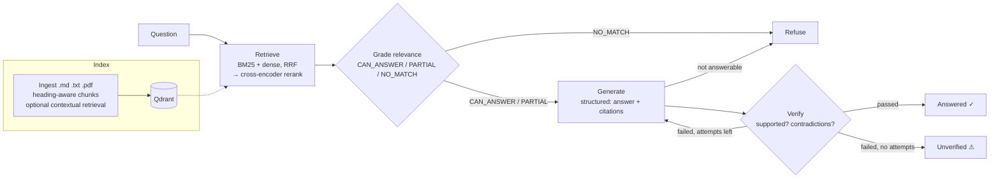

# Verified Doc QA

**Question answering over your documents that knows when to say "I don't know". It checks whether
the documents can answer at all, answers with citations, fact-checks its own answer against the
sources, and tells you whether the answer was verified.**

> "How many unused leave days can I carry over?" → *"Up to 5 unused days can be carried over;
> they expire on 31 March [1]."* · **Verified** · [1] leave-policy.md › Annual leave
>
> "Who is the CEO?" → *"I can't answer that from the indexed documents."* · **Not in documents**

<!-- demo GIF: docs/demo.gif (record with the Streamlit UI) -->

## Why this project
Plain RAG fails quietly. It answers off-topic questions from the model's memory, cites sources
that don't say what the answer says, and gives no signal when it is guessing. This project wraps
retrieval in an agentic workflow with two gates, and it **measures** both retrieval quality and
answer quality.

## Architecture



- **LangGraph** `StateGraph` with conditional edges and a bounded retry loop. The verifier's list
  of unsupported claims is sent back to the generator as feedback.
- **Structured outputs** (Pydantic) at every LLM step. No parsing of free-text labels.
- **Citations are checked**: `[n]` markers that point outside the retrieved set are dropped, and an
  answer that cites nothing can never pass verification.
- The response includes the status, citations with their text, everything retrieved, the
  verification report, the attempts, and per-node timings.

## Evaluation

`make eval` indexes the bundled corpus into a fresh in-memory collection and runs
`evals/qa_cases.jsonl`: 35 hand-labelled questions. 27 are answerable, each with a gold document,
an evidence sentence and key facts. 8 are unanswerable (they test refusal).

**1. Retrieval ablation** (answerable questions; a hit is the first chunk containing the evidence sentence)

| Retrieval | hit@1 | recall@5 | MRR@10 |
|---|---|---|---|
| BM25 | _run `make eval`_ | | |
| Dense (`nomic-embed-text`) | | | |
| Hybrid (RRF 0.4 / 0.6) | | | |
| Hybrid + cross-encoder rerank | | | |

Offline sanity run (`make eval-fake`, CI): with a bag-of-words *hashing* embedding instead of a real
model, BM25 89% / 100% / 0.935, "dense" 85% / 96% / 0.902, hybrid 89% / 100% / 0.935
(hit@1 / recall@5 / MRR@10). The corpus is small and keyword-friendly. Real embeddings matter more
on paraphrased questions, which is what the table above is for.

**2. End to end**

| Metric | `ollama:qwen3:8b` | `openai:gpt-4o-mini` |
|---|---|---|
| Unanswerable correctly refused | _run `make eval`_ | |
| Answerable not refused | | |
| Key-fact accuracy | | |
| Citation precision (cited chunk from the gold doc) | | |
| Verified rate | | |
| Judge faithfulness / correctness (1-5) | | |
| Mean attempts · median latency | | |

`evals/results.md` is written by each run, ready to paste here.

## Quick start

```bash
git clone <this repo> && cd verified-doc-qa
python -m venv .venv && source .venv/bin/activate
make install                              # pip install -e ".[dev,ui,rerank]"
ollama pull qwen3:8b && ollama pull nomic-embed-text   # or LLM_PROVIDER=openai (see .env.example)

docqa ingest corpus                       # or your own folder of .md / .txt / .pdf
docqa ask "Can I fly premium economy on a 7-hour flight?"
make api                                  # http://localhost:8000/docs
make ui                                   # http://localhost:8501 (needs the API running)
make test                                 # offline: scripted model + hashing embeddings
```

Docker (API + UI + Ollama + Qdrant):

```bash
docker compose up --build
docker compose exec ollama ollama pull qwen3:8b
docker compose exec ollama ollama pull nomic-embed-text
docker compose exec api docqa ingest corpus
```

### API

| Method | Path                  |                                                                                             |
| ------ | --------------------- | ------------------------------------------------------------------------------------------- |
| POST   | `/ingest`             | multipart `files` (.md, .txt, .pdf). Re-uploading a file replaces its chunks                |
| GET    | `/documents`          | indexed documents and their chunk counts                                                    |
| DELETE | `/documents/{source}` | remove a document                                                                           |
| POST   | `/ask`                | `{"question": "..."}` → status, answer, citations, retrieved, verification, attempts, steps |
| GET    | `/health`             | provider, models, retrieval settings                                                        |


## Project layout

```
src/verified_doc_qa/
  config.py    settings from env / .env
  llm.py       chat + embedding factories (ollama | openai | anthropic | fake), scripted fake model
  ingest.py    loaders, heading-aware chunking, contextual retrieval
  store.py     Qdrant + BM25 over the same chunks
  retrieve.py  dense | bm25 | hybrid (RRF) → rerank → top-n
  graph.py     LangGraph workflow → AskResponse
  api.py ui.py cli.py
corpus/        a fictional company handbook (written for this repo)
evals/         qa_cases.jsonl + run_eval.py
tests/         chunking, BM25/RRF, store, every graph path, API, eval metrics (all offline)
```
